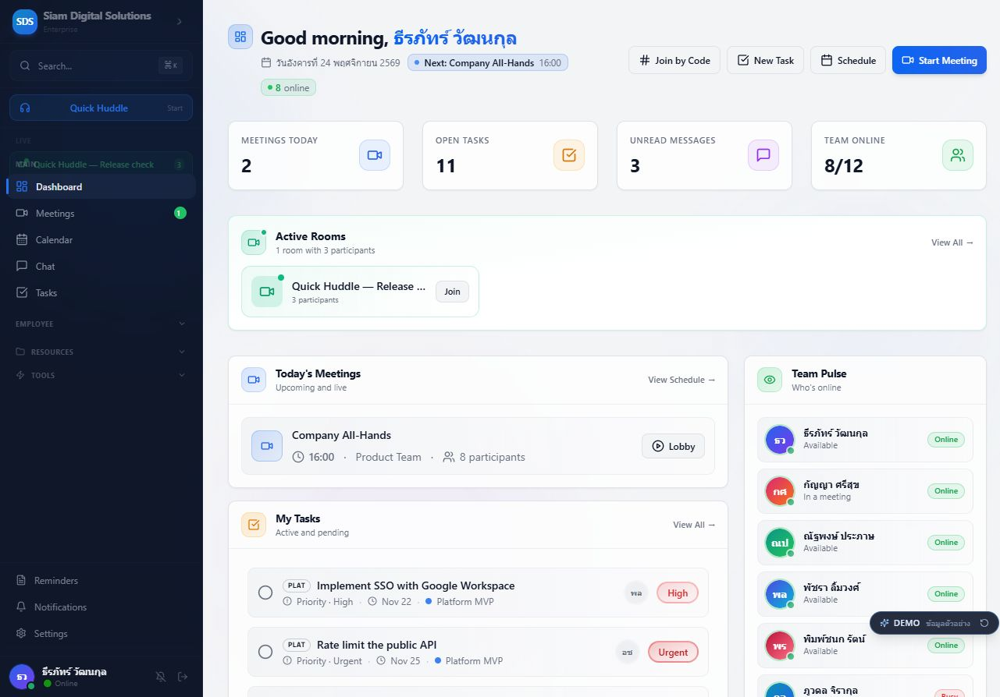
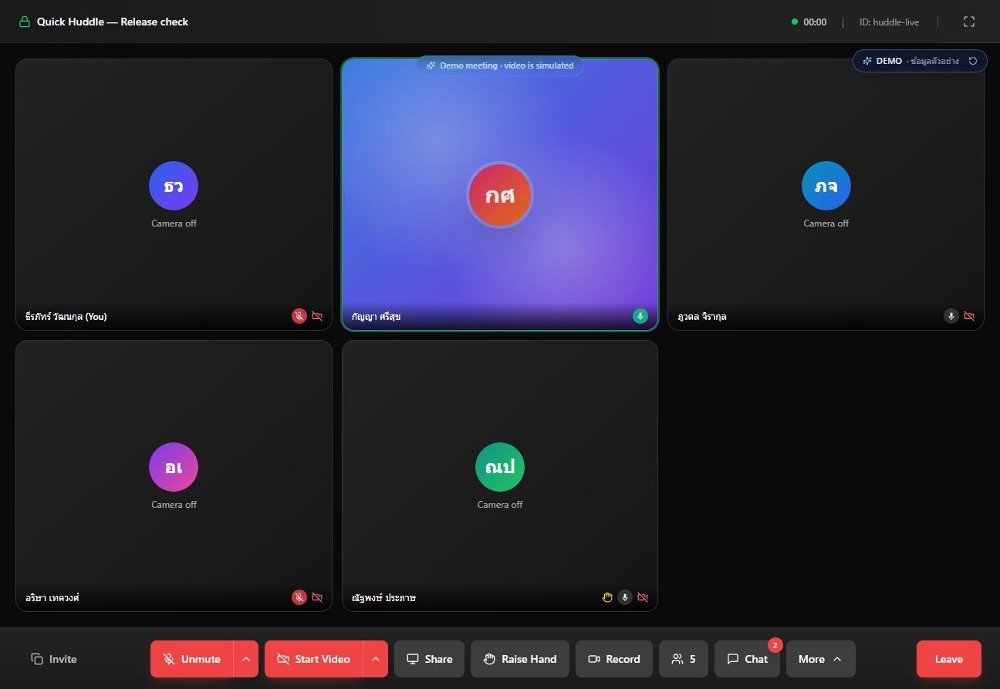

# Team Connect

[](https://app.netlify.com/projects/team-connect-demo/deploys)
[](https://team-connect-demo.netlify.app)

Team Connect is a team workspace for meetings, chat, tasks, files and reporting.
This repository contains the React frontend, configured to run as a demo with an
in-browser mock API. It needs no database or backend and deploys as a static site.

**Demo:** https://team-connect-demo.netlify.app
**Login:** `demo@siamdigital.co.th` / `demo1234`

The login screen also has a one-click demo button.



## Features

- Dashboard with today's meetings, open tasks, online teammates and live rooms
- Meetings, join lobby and a simulated meeting room with chat, hand raise and screen sharing
- Channels and direct messages with threads, reactions, pinned messages and search
- Tasks with kanban, list and calendar views, plus subtasks, comments, attachments and links
- Teams, directory, invitations, roles and permissions, organization settings and audit log
- Shared drive with folders, uploads, file versions and per-file access
- Wiki, announcements, reminders and notifications
- Reports with charts and CSV, Excel, JSON and PDF export

## Demo mode

Everything is served from `src/lib/demo`:

- a mock REST API for the endpoints the UI calls
- seeded workspace data
- a simulated Socket.IO connection for presence and live updates
- localStorage persistence under `teamconnect_demo_db_v1`

The DEMO badge in the bottom-right corner resets the sample data. Each visitor
gets their own copy; nothing is sent to a server.

The meeting room is simulated on purpose. Participant tiles are sample data and
the camera preview uses the local webcam only when permission is granted.



## Running locally

Node.js 20 or newer.

```bash
npm install
npm run dev:demo
```

The app runs at http://localhost:8080.

To connect the NestJS API instead, run `npm run dev` with `VITE_API_URL` set. The
backend lives at [Mindenry/backend-meeting](https://github.com/Mindenry/backend-meeting).

## Build and deploy

```bash
npm run build       # demo build used by Netlify
npm run build:real  # build against VITE_API_URL
npm run preview
```

Netlify deploys from `main` on every push. The included `netlify.toml` sets the
build command, SPA redirect, security headers and demo flag. For a manual deploy:

```bash
npm run build
npx netlify deploy --prod --dir=dist
```

## Notes

- Uploaded files are stored as data URLs. Very large files stay in memory and are lost on refresh.
- Report exports run in the browser, so no export service is needed.
- The demo data is per browser, not shared between visitors.

## Project structure

```text
src/lib/demo/     mock API, seed data, persistence and socket simulation
src/pages/        application pages, including DemoMeetingRoom.tsx
src/components/   shared UI components
docs/             screenshots
```
